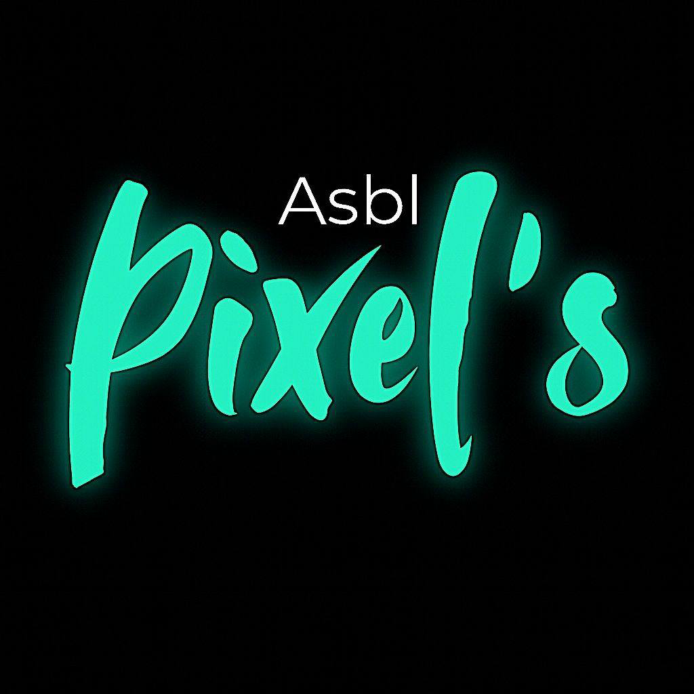

<div align="center">



# 🎬 RipDvD

### Del disco al digital — sin esfuerzo.

**Un extractor de DVD minimalista y de código abierto para Linux (Fedora / GNOME)**

[](LICENSE)
[](https://github.com/asblPixels/ripdvd)
[](https://gnome.org/)
[](https://gnome.org/)
[](https://www.python.org/)
[](https://handbrake.fr/)
[](https://github.com/asblPixels/ripdvd/actions/workflows/ci.yml)
[](https://github.com/asblPixels/ripdvd/releases)

<br>

[🇬🇧 English](README.md) · [🇫🇷 Français](README.fr.md) · [🇪🇸 Español](README.es.md) · [🇷🇺 Русский](README.ru.md) · [🇨🇳 中文](README.zh.md) · [🇯🇵 日本語](README.ja.md)

</div>

---

## 📖 Acerca de

**RipDvD** es una aplicación gratuita y de código abierto para extraer DVD en Linux y Windows.
Proporciona una interfaz gráfica nativa (GTK4 / libadwaita en Linux, tkinter en Windows) sobre
[HandBrakeCLI](https://handbrake.fr/), convirtiendo tu colección de DVD en archivos MKV
de alta calidad listos para tu servidor multimedia (Jellyfin, Kodi, Plex).

> **Origen**: Este proyecto es creado y mantenido por **[asblPixels](https://github.com/asblPixels)**
> como parte de su iniciativa de software de código abierto. Se publica bajo licencia MIT
> y es libre de usar, modificar y distribuir.

### ✨ ¿Por qué RipDvD?

La mayoría de los extractores de DVD son solo de línea de comandos, demasiado complejos,
bloqueados a una plataforma o solo para Windows. RipDvD busca ser **la herramienta más simple posible** que funciona en todas partes: inserta un disco, haz clic en un botón,
obtén un MKV perfecto. Sin configuración necesaria, pero con control total si lo deseas.
Funciona en **Fedora, Arch, Ubuntu, Debian** (Linux) y **Windows 10/11**.

## 🎯 Características

- 🖱️ **Extracción con un clic** — inserta un DVD, haz clic en *Rip DVD*, obtén un MKV listo para streaming.
- 🔍 **Detección automática del título** — selecciona el título más largo (la película principal).
- 🌍 **Audio multilingüe** — detecta todas las pistas de audio; francés por defecto, luego inglés.
- 💬 **Subtítulos** — passthrough opcional de cualquier pista de subtítulos (VobSub), o ninguno.
- 📑 **Marcadores de capítulos** — preservados en el MKV para fácil navegación en Jellyfin/Kodi.
- 📺 **Ventana de salida en vivo** — log de HandBrakeCLI en tiempo real con auto-scroll.
- 📊 **Barra de progreso** — porcentaje actualizado en vivo durante la codificación.
- ⏸️ **Botón Detener** — cancela una codificación en curso en cualquier momento.
- 🔄 **Botón Reanudar** — reintenta la última codificación con los mismos parámetros.
- 🚪 **Botón Salir** — cierra la aplicación limpiamente (detiene cualquier codificación en curso).
- 🔄 **Botón Rescanear** — re-analiza el disco sin reiniciar la aplicación.
- 🧹 **Borrar log** — limpia la ventana de salida en vivo.
- 🎨 **Apariencia nativa de GNOME** — GTK4 + libadwaita, se integra perfectamente en Fedora Workstation.
- 🧵 **Thread-safe** — todas las actualizaciones de la interfaz se envían al hilo principal de GTK.
- 🐛 **Log de depuración** — salida completa guardada en `~/.ripdvd-debug.log`.

## 📋 Perfil de salida por defecto

| Parámetro | Valor |
|---|---|
| Contenedor | MKV (Matroska) |
| Códec de video | H.264 (x264), RF 20, preset `medium` |
| Resolución | Nativa del DVD (480p NTSC / 576p PAL) — sin upscaling |
| Framerate | Fuente (25 / 29,97 fps) |
| Audio | Passthrough (copia) — conserva el 5.1 original si está presente |
| Subtítulos | Passthrough (opcional) |
| Capítulos | Preservados |
| Tamaño típico | ~1,0 – 1,5 GB por película de 2 horas |

> 💡 Los DVD son fuentes SD. Mantener la resolución nativa evita el upscaling artificial y mantiene
> los archivos pequeños mientras se ven geniales en cualquier TV.

## 🖥️ Sistemas soportados

| Componente | Requisito |
|---|---|
| **Sistema operativo** | Fedora 43+ (probado en Fedora 45). Cualquier distro reciente basada en Fedora/RHEL debería funcionar. |
| **Escritorio** | GNOME (GTK4/libadwaita). Funciona en X11 y Wayland. |
| **Arquitectura** | x86_64 |
| **CPU** | Cualquier x86_64 (codificación por software vía x264). No se requiere GPU. |
| **RAM** | 2 GB mínimo, 4 GB recomendados |
| **Disco** | ~1,5 GB libre por película (salida) + ~8 GB temp durante la codificación |
| **Lector óptico** | Lector de DVD interno o USB (aparece como `/dev/sr0`) |

### Distribuciones soportadas

Este repositorio proporciona ramas por distribución con instaladores adaptados:

| Rama | Distribución | Script de instalación |
|---|---|---|
| `main` / `fedora` | Fedora 43+ | `scripts/install.sh` |
| `arch` | Arch Linux | `scripts/install-arch.sh` |
| `ubuntu` | Ubuntu 22.04+ | `scripts/install-ubuntu.sh` |
| `debian` | Debian 12+ | `scripts/install-debian.sh` |
| `windows` | Windows 10/11 | `scripts/install-windows.ps1` |

Para usar una rama específica:

```bash
git clone -b <rama> https://github.com/asblPixels/ripdvd.git
cd ripdvd
bash scripts/install-<distro>.sh   # o .ps1 en Windows
```

## 🚀 Instalación

### ⚡ Instalación en una línea (recomendada)

**Copia y pega este único comando en tu terminal:**

```bash
curl -fsSL https://raw.githubusercontent.com/asblPixels/ripdvd/main/scripts/install-linux.sh | bash
```

¡Eso es todo! El instalador va a:
1. Detectar automáticamente tu distribución Linux.
2. Instalar todas las dependencias necesarias.
3. Descargar e instalar RipDvD.
4. Configurar una entrada de menú.

> **No se requieren conocimientos técnicos.** Copia, pega, presiona Enter.

### Paso 1 — Descargar (manual)

```bash
git clone https://github.com/asblPixels/ripdvd.git
cd ripdvd
```

> ¿No tienes `git`? Descarga el ZIP desde
> https://github.com/asblPixels/ripdvd/archive/refs/heads/main.zip y extráelo.

### Paso 2 — Instalar dependencias

```bash
sudo dnf install -y python3 python3-gobject gtk4 libadwaita zenity HandBrake HandBrake-cli
```

Para DVD comerciales cifrados, instala también `libdvdcss`:

```bash
sudo dnf install -y rpmfusion-free-release-tainted
sudo dnf install -y libdvdcss
```

### Paso 3 — Ejecutar el instalador

```bash
bash scripts/install.sh
```

El instalador va a:
1. Verificar las dependencias Python/GTK.
2. Instalar HandBrake (nativo, con respaldo Flatpak si el nativo no está disponible).
3. Copiar la app a `~/.local/bin/ripdvd-gui.py`.
4. Registrar una entrada de menú GNOME (`ripdvd`).

### Paso 4 — Lanzar

```bash
python3 ~/.local/bin/ripdvd-gui.py
```

O busca **RipDvD** en el menú de aplicaciones de GNOME.

### Windows

Para Windows 10/11, descarga el ZIP desde https://github.com/asblPixels/ripdvd/archive/refs/heads/windows.zip, extráelo y haz doble clic en `install-windows.bat`. No se requieren conocimientos técnicos.

### Verificar que todo funciona

```bash
python3 -c "import gi; gi.require_version('Gtk','4.0'); gi.require_version('Adw','1'); print('GTK4/Adw OK')"
command -v HandBrakeCLI && echo "HandBrakeCLI OK"
```

Ambos deben imprimir `OK`.

## 🎬 Uso

1. Inserta un DVD en tu lector.
2. Lanza **RipDvD** desde el menú de GNOME (o `python3 ~/.local/bin/ripdvd-gui.py`).
3. La app escanea el disco automáticamente y detecta la película principal (título más largo).
4. Elige el **idioma de audio** y los **subtítulos** opcionales en los menús desplegables.
5. Haz clic en **Rip DVD**.
6. Observa el progreso en vivo en la ventana de log.
7. El MKV final se guarda en `~/Vidéos/Rips/` (o `~/Videos/Rips/`).

### Botones

| Botón | Acción |
|---|---|
| **Rip DVD** | Inicia la codificación del título seleccionado. |
| **Arrêter** | Cancela la codificación en curso. |
| **Reprendre** | Reanuda/reintenta la última codificación con los mismos parámetros. |
| **Quitter** | Cierra la aplicación (detiene cualquier codificación en curso). |
| **Rescanner** | Re-analiza el disco (útil después de cambiar de DVD). |
| **Effacer log** | Limpia la ventana de salida en vivo. |

### Versión CLI

También se proporciona un script bash headless para automatización:

```bash
bash src/ripdvd-cli.sh
```

Detecta automáticamente el título más largo y lo rippea con los mismos parámetros por defecto, mostrando el progreso vía `zenity`.

## 🗂️ Estructura del proyecto

```
ripdvd/
├── src/
│   ├── ripdvd.py          # Aplicación GUI GTK4/libadwaita
│   └── ripdvd-cli.sh      # Ripper CLI headless
├── scripts/
│   └── install.sh         # Instalador para Fedora
├── data/
│   └── ripdvd.desktop     # Entrada de menú GNOME
├── docs/
│   └── screenshot-main.png
├── .github/
│   ├── workflows/         # CI (verificaciones de sintaxis)
│   └── ISSUE_TEMPLATE/
├── README.md
├── LICENSE
├── CONTRIBUTING.md
└── .gitignore
```

## 🐛 Solución de problemas

### La app no inicia — `ModuleNotFoundError: No module named 'gi'`
Instala PyGObject: `sudo dnf install python3-gobject gtk4 libadwaita`

### Segfault / crash al iniciar
Asegúrate de estar en la última versión (actualizaciones thread-safe de la interfaz). Relanza `bash scripts/install.sh`.

### DVD no detectado (`/dev/sr0` no encontrado)
- Verifica que el lector esté conectado: `lsblk | grep sr`
- Algunos lectores USB necesitan un momento después de insertar; haz clic en **Rescanner**.

### Pantalla negra / "cannot read disc" en DVD cifrados
Instala `libdvdcss`:
```bash
sudo dnf install rpmfusion-free-release-tainted
sudo dnf install libdvdcss
```

### Archivo de salida vacío
Abre el log de depuración (`~/.ripdvd-debug.log`) o haz clic en **Voir le log de debug**. Las últimas líneas muestran el error de HandBrake. Causas comunes:
- `libdvdcss` faltante para discos cifrados.
- HandBrake Flatpak sin `--device=all` (corregido en la versión actual).
- Espacio en disco insuficiente en `~/Vidéos/Rips/`.

### Codificación lenta en CPU antiguos
Es normal — la codificación por software x264 en un i3 Sandy Bridge toma ~10-15 min por película. La app usa el preset `medium` para un buen equilibrio calidad/velocidad. Para rips más rápidos, edita `--encoder-preset` a `fast` o `veryfast` en `src/ripdvd.py`.

## 🙏 Agradecimientos

Este proyecto no existiría sin el increíble trabajo de:

- **[HandBrake](https://handbrake.fr/)** y su equipo — el motor de codificación que lo hace todo funcionar.
- **[libdvdcss](https://www.videolan.org/developers/libdvdcss.html)** (VideoLAN) — el descifrado de DVD.
- **[GNOME / GTK4 / libadwaita](https://gnome.org/)** — el kit de herramientas de interfaz.
- **[RPM Fusion](https://rpmfusion.org/)** — el empaquetado para Fedora.
- **[Proyecto Fedora](https://fedoraproject.org/)** — el sistema operativo.
- Todos los contribuidores de código abierto y la comunidad.

## 📚 Fuentes y referencias

- Documentación CLI de HandBrake: https://handbrake.fr/docs/en/latest/cli/
- Documentación de libdvdcss: https://www.videolan.org/developers/libdvdcss.html
- Documentación de GTK4 / libadwaita: https://docs.gtk.org/gtk4/ y https://gnome.pages.gitlab.gnome.org/libadwaita/
- Documentación de PyGObject: https://pygobject.readthedocs.io/
- Configuración de RPM Fusion: https://rpmfusion.org/Configuration
- Guía multimedia de Fedora: https://docs.fedoraproject.org/en-US/quick-docs/assembly_installing-plugins-for-playing-movies-and-music/

## 👨‍💻 Creadores

**RipDvD** es creado y mantenido por **[asblPixels](https://github.com/asblPixels)**
como parte de su iniciativa de software de código abierto.

¡Las contribuciones, reportes de bugs y solicitudes de funcionalidades son bienvenidas!

## 📜 Licencia

Este proyecto está bajo licencia **MIT** — ver [LICENSE](LICENSE) para los detalles.

## ⚠️ Nota legal

Esta herramienta está destinada a la copia de seguridad de DVD que posees para uso personal.
Descifrar discos protegidos por copia puede estar restringido en tu país. Consulta las leyes locales.

---

<div align="center">

Hecho con ❤️ por [asblPixels](https://github.com/asblPixels) · Código Abierto · Licencia MIT

</div>
