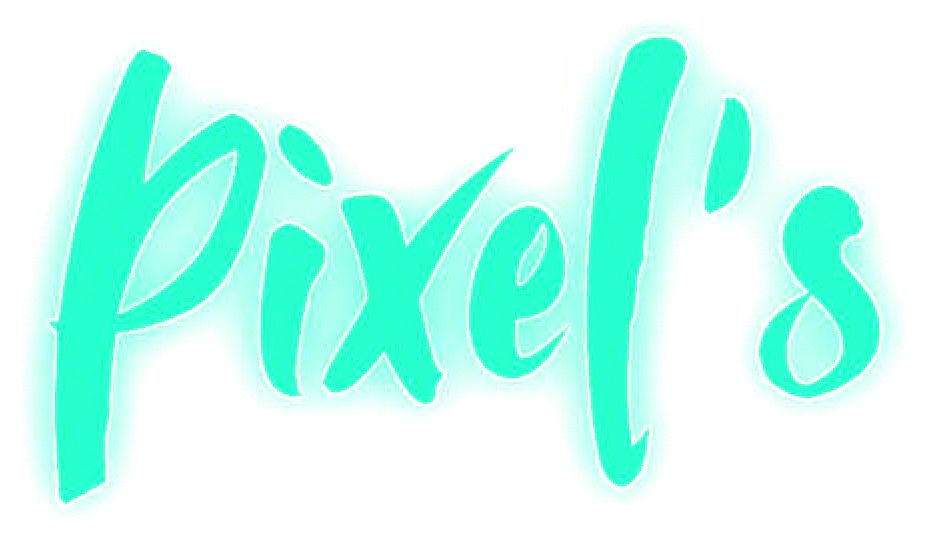

<div align="center">



# 🎬 RipDvD

### ディスクからデジタルへ — 手軽に。

**Linux (Fedora / GNOME) 向けのミニマリストなオープンソース DVD リッピングツール**

[](LICENSE)
[](https://github.com/asblPixels/ripdvd)
[](https://gnome.org/)
[](https://gnome.org/)
[](https://www.python.org/)
[](https://handbrake.fr/)
[](https://github.com/asblPixels/ripdvd/actions/workflows/ci.yml)
[](https://github.com/asblPixels/ripdvd/releases)

<br>

[🇬🇧 English](README.md) · [🇫🇷 Français](README.fr.md) · [🇪🇸 Español](README.es.md) · [🇷🇺 Русский](README.ru.md) · [🇨🇳 中文](README.zh.md) · [🇯🇵 日本語](README.ja.md)

</div>

---

## 📖 概要

**RipDvD** は Linux と Windows 向けの無料オープンソース DVD リッピングアプリケーションです。
[HandBrakeCLI](https://handbrake.fr/) の上にネイティブ GUI（Linux では GTK4 / libadwaita、Windows では tkinter）を提供し、
DVD コレクションを高品質な MKV ファイルに変換してホームメディアサーバー（Jellyfin、Kodi、Plex）で利用できます。

> **由来**: このプロジェクトは **[asblPixels](https://github.com/asblPixels)** によって
> オープンソースソフトウェアイニシアティブの一環として作成・維持されています。
> MIT ライセンスの下で公開され、自由に使用、変更、配布できます。

### ✨ なぜ RipDvD なのか？

ほとんどの DVD リッピングツールはコマンドラインのみ、複雑すぎる、プラットフォームにロックされている、または Windows 専用です。
RipDvD は **どこでも動作する可能な限りシンプルなツール**を目指しています：ディスクを挿入し、ボタンをクリックし、
完璧な MKV を取得。設定不要ですが、必要に応じて完全な制御も可能です。
**Fedora、Arch、Ubuntu、Debian** (Linux) および **Windows 10/11** で動作します。

## 🎯 機能

- 🖱️ **ワンクリックリッピング** — DVD を挿入し、*Rip DVD* をクリック、ストリーミング可能な MKV を取得。
- 🔍 **自動タイトル検出** — 最も長いタイトル（メイン映画）を自動選択。
- 🌍 **多言語オーディオ** — すべてのオーディオトラックを検出；デフォルトでフランス語、次に英語。
- 💬 **字幕** — 任意の字幕トラック（VobSub）のパススルー、またはなし。
- 📑 **チャプターマーカー** — Jellyfin/Kodi での簡単なナビゲーションのため MKV に保持。
- 📺 **ライブ出力ウィンドウ** — 自動スクロール付きのリアルタイム HandBrakeCLI ログ。
- 📊 **プログレスバー** — エンコード中にリアルタイムでパーセンテージ更新。
- ⏸️ **停止ボタン** — 進行中のエンコードをいつでもキャンセル。
- 🔄 **再開ボタン** — 同じパラメータで最後のエンコードを再試行。
- 🚪 **終了ボタン** — アプリをクリーンに終了（実行中のエンコードを先に停止）。
- 🔄 **再スキャンボタン** — アプリを再起動せずにディスクを再分析。
- 🧹 **ログクリア** — ライブ出力ウィンドウをクリア。
- 🎨 **ネイティブ GNOME ルック** — GTK4 + libadwaita、Fedora Workstation に完璧にフィット。
- 🧵 **スレッドセーフ** — すべての UI 更新は GTK メインスレッドにマーシャリング。
- 🐛 **デバッグログ** — 完全な出力を `~/.ripdvd-debug.log` に保存。

## 📋 デフォルト出力プロファイル

| パラメータ | 値 |
|---|---|
| コンテナ | MKV (Matroska) |
| ビデオコーデック | H.264 (x264), RF 20, プリセット `medium` |
| 解像度 | ネイティブ DVD (480p NTSC / 576p PAL) — アップスケーリングなし |
| フレームレート | ソース (25 / 29.97 fps) |
| オーディオ | パススルー (コピー) — オリジナルの 5.1 を保持（存在する場合） |
| 字幕 | パススルー (オプション) |
| チャプター | 保持 |
| 典型的なサイズ | 2 時間映画あたり ~1.0 – 1.5 GB |

> 💡 DVD は SD ソースです。ネイティブ解像度を維持することで人工的な
> アップスケーリングを避け、ファイルを小さく保ちながらあらゆるテレビで美しく表示されます。

## 🖥️ サポートされるシステム

| コンポーネント | 要件 |
|---|---|
| **オペレーティングシステム** | Fedora 43+ (Fedora 45 でテスト済み)。最近の Fedora/RHEL ベースのディストリビューションなら動作するはずです。 |
| **デスクトップ** | GNOME (GTK4/libadwaita)。X11 と Wayland の両方で動作。 |
| **アーキテクチャ** | x86_64 |
| **CPU** | 任意の x86_64 (x264 によるソフトウェアエンコード)。GPU 不要。 |
| **RAM** | 最低 2 GB、推奨 4 GB |
| **ディスク** | 映画 1 本あたり ~1.5 GB の空き (出力) + エンコード中に ~8 GB の一時領域 |
| **光学ドライブ** | 内蔵または USB DVD リーダー (`/dev/sr0` として表示) |

### サポートされるディストリビューション

このリポジトリは、適応されたインストーラーを備えたディストリビューション別のブランチを提供しています：

| ブランチ | ディストリビューション | インストールスクリプト |
|---|---|---|
| `main` / `fedora` | Fedora 43+ | `scripts/install.sh` |
| `arch` | Arch Linux | `scripts/install-arch.sh` |
| `ubuntu` | Ubuntu 22.04+ | `scripts/install-ubuntu.sh` |
| `debian` | Debian 12+ | `scripts/install-debian.sh` |
| `windows` | Windows 10/11 | `scripts/install-windows.ps1` |

特定のブランチを使用するには：

```bash
git clone -b <ブランチ> https://github.com/asblPixels/ripdvd.git
cd ripdvd
bash scripts/install-<distro>.sh   # または Windows では .ps1
```

## 🚀 インストール

### ⚡ ワンラインインストール（推奨）

**この一行のコマンドをターミナルにコピー＆ペースト：**

```bash
curl -fsSL https://raw.githubusercontent.com/asblPixels/ripdvd/main/scripts/install-linux.sh | bash
```

それだけです！インストーラーが：
1. Linux ディストリビューションを自動検出。
2. 必要なすべての依存関係をインストール。
3. RipDvD をダウンロードしてインストール。
4. メニュー項目を設定。

> **技術的な知識は不要です。** コピー、ペースト、Enter。

### ステップ 1 — ダウンロード（手動）

```bash
git clone https://github.com/asblPixels/ripdvd.git
cd ripdvd
```

> `git` がない場合？ https://github.com/asblPixels/ripdvd/archive/refs/heads/main.zip から
> ZIP をダウンロードして展開してください。

### ステップ 2 — 依存関係のインストール

```bash
sudo dnf install -y python3 python3-gobject gtk4 libadwaita zenity HandBrake HandBrake-cli
```

暗号化された市販 DVD の場合、`libdvdcss` もインストール：

```bash
sudo dnf install -y rpmfusion-free-release-tainted
sudo dnf install -y libdvdcss
```

### ステップ 3 — インストーラーの実行

```bash
bash scripts/install.sh
```

インストーラーは：
1. Python/GTK 依存関係を検証。
2. HandBrake をインストール（ネイティブ、ネイティブが利用できない場合は Flatpak をフォールバック）。
3. アプリを `~/.local/bin/ripdvd-gui.py` にコピー。
4. GNOME メニュー項目 (`ripdvd`) を登録。

### ステップ 4 — 起動

```bash
python3 ~/.local/bin/ripdvd-gui.py
```

または GNOME アプリケーションメニューで **RipDvD** を検索。

### 動作確認

```bash
python3 -c "import gi; gi.require_version('Gtk','4.0'); gi.require_version('Adw','1'); print('GTK4/Adw OK')"
command -v HandBrakeCLI && echo "HandBrakeCLI OK"
```

両方とも `OK` と表示されるはずです。

## 🎬 使い方

1. DVD をドライブに挿入。
2. GNOME アプリケーションメニューから **RipDvD** を起動（または `python3 ~/.local/bin/ripdvd-gui.py`）。
3. アプリが自動的にディスクをスキャンし、メイン映画（最長のタイトル）を検出。
4. ドロップダウンから **オーディオ言語** とオプションの **字幕** を選択。
5. **Rip DVD** をクリック。
6. ログウィンドウでリアルタイムの進捗を確認。
7. 完成した MKV は `~/Vidéos/Rips/` (または `~/Videos/Rips/`) に保存されます。

### ボタン

| ボタン | アクション |
|---|---|
| **Rip DVD** | 選択したタイトルのエンコードを開始。 |
| **Arrêter** | 現在のエンコードをキャンセル。 |
| **Reprendre** | 同じパラメータで最後のエンコードを再試行。 |
| **Quitter** | アプリを終了（実行中のエンコードを先に停止）。 |
| **Rescanner** | ディスクを再分析（DVD を交換した後に便利）。 |
| **Effacer log** | ライブ出力ウィンドウをクリア。 |

### CLI バージョン

自動化用のヘッドレス bash スクリプトも提供：

```bash
bash src/ripdvd-cli.sh
```

最長のタイトルを自動検出して同じデフォルトパラメータでリップし、`zenity` で進捗を表示します。

## 🗂️ プロジェクト構造

```
ripdvd/
├── src/
│   ├── ripdvd.py          # GTK4/libadwaita GUI アプリケーション
│   └── ripdvd-cli.sh      # ヘッドレス CLI リッパー
├── scripts/
│   └── install.sh         # Fedora インストーラー
├── data/
│   └── ripdvd.desktop     # GNOME メニュー項目
├── docs/
│   └── screenshot-main.png
├── .github/
│   ├── workflows/         # CI (構文チェック)
│   └── ISSUE_TEMPLATE/
├── README.md
├── LICENSE
├── CONTRIBUTING.md
└── .gitignore
```


### Windows

Windows 10/11 の場合、https://github.com/asblPixels/ripdvd/archive/refs/heads/windows.zip から ZIP をダウンロードし、展開して `install-windows.bat` をダブルクリックしてください。技術的な知識は不要です。

## 🐛 トラブルシューティング

### アプリが起動しない — `ModuleNotFoundError: No module named 'gi'`
PyGObject をインストール：`sudo dnf install python3-gobject gtk4 libadwaita`

### 起動時の Segfault / クラッシュ
最新バージョンであることを確認（スレッドセーフな UI 更新）。`bash scripts/install.sh` を再実行。

### DVD が検出されない (`/dev/sr0` が見つからない)
- ドライブが接続されているか確認：`lsblk | grep sr`
- 一部の USB ドライブは挿入後に少し時間が必要；**Rescanner** をクリック。

### 暗号化された DVD でブラック画面 / "cannot read disc"
`libdvdcss` をインストール：
```bash
sudo dnf install rpmfusion-free-release-tainted
sudo dnf install libdvdcss
```

### 出力ファイルが空
デバッグログ (`~/.ripdvd-debug.log`) を開くか **Voir le log de debug** をクリック。最後の行に HandBrake エラーが表示されます。一般的な原因：
- 暗号化されたディスクに `libdvdcss` がない。
- `--device=all` なしの HandBrake Flatpak (現在のバージョンで修正済み)。
- `~/Vidéos/Rips/` のディスク容量不足。

### 古い CPU での低速エンコード
これは正常です — Sandy Bridge i3 での x264 ソフトウェアエンコードは映画 1 本あたり ~10-15 分かかります。アプリは良好な品質/速度バランスのために `medium` プリセットを使用します。より高速なリップには `src/ripdvd.py` の `--encoder-preset` を `fast` または `veryfast` に変更。

## 🙏 謝辞

このプロジェクトは以下の素晴らしい仕事なしには存在しません：

- **[HandBrake](https://handbrake.fr/)** とそのチーム — すべてを動かすエンコードエンジン。
- **[libdvdcss](https://www.videolan.org/developers/libdvdcss.html)** (VideoLAN) — DVD 復号。
- **[GNOME / GTK4 / libadwaita](https://gnome.org/)** — UI ツールキット。
- **[RPM Fusion](https://rpmfusion.org/)** — Fedora 向けパッケージング。
- **[Fedora プロジェクト](https://fedoraproject.org/)** — オペレーティングシステム。
- すべてのオープンソースコントリビューターとコミュニティ。

## 📚 ソースと参考文献

- HandBrake CLI ドキュメント: https://handbrake.fr/docs/en/latest/cli/
- libdvdcss ドキュメント: https://www.videolan.org/developers/libdvdcss.html
- GTK4 / libadwaita ドキュメント: https://docs.gtk.org/gtk4/ および https://gnome.pages.gitlab.gnome.org/libadwaita/
- PyGObject ドキュメント: https://pygobject.readthedocs.io/
- RPM Fusion 設定: https://rpmfusion.org/Configuration
- Fedora マルチメディアガイド: https://docs.fedoraproject.org/en-US/quick-docs/assembly_installing-plugins-for-playing-movies-and-music/

## 👨‍💻 作成者

**RipDvD** は **[asblPixels](https://github.com/asblPixels)** によって
オープンソースソフトウェアイニシアティブの一環として作成・維持されています。

貢献、バグ報告、機能リクエストを歓迎します！

## 📜 ライセンス

このプロジェクトは **MIT ライセンス** の下でライセンスされています — 詳細は [LICENSE](LICENSE) をご覧ください。

## ⚠️ 法的注意

このツールは個人使用のために所有する DVD をバックアップすることを目的としています。
著作権保護されたディスクの復号は、お住まいの国で制限されている場合があります。現地の法律を確認してください。

---

<div align="center">

[asblPixels](https://github.com/asblPixels) が ❤️ を込めて作成 · オープンソース · MIT ライセンス

</div>
