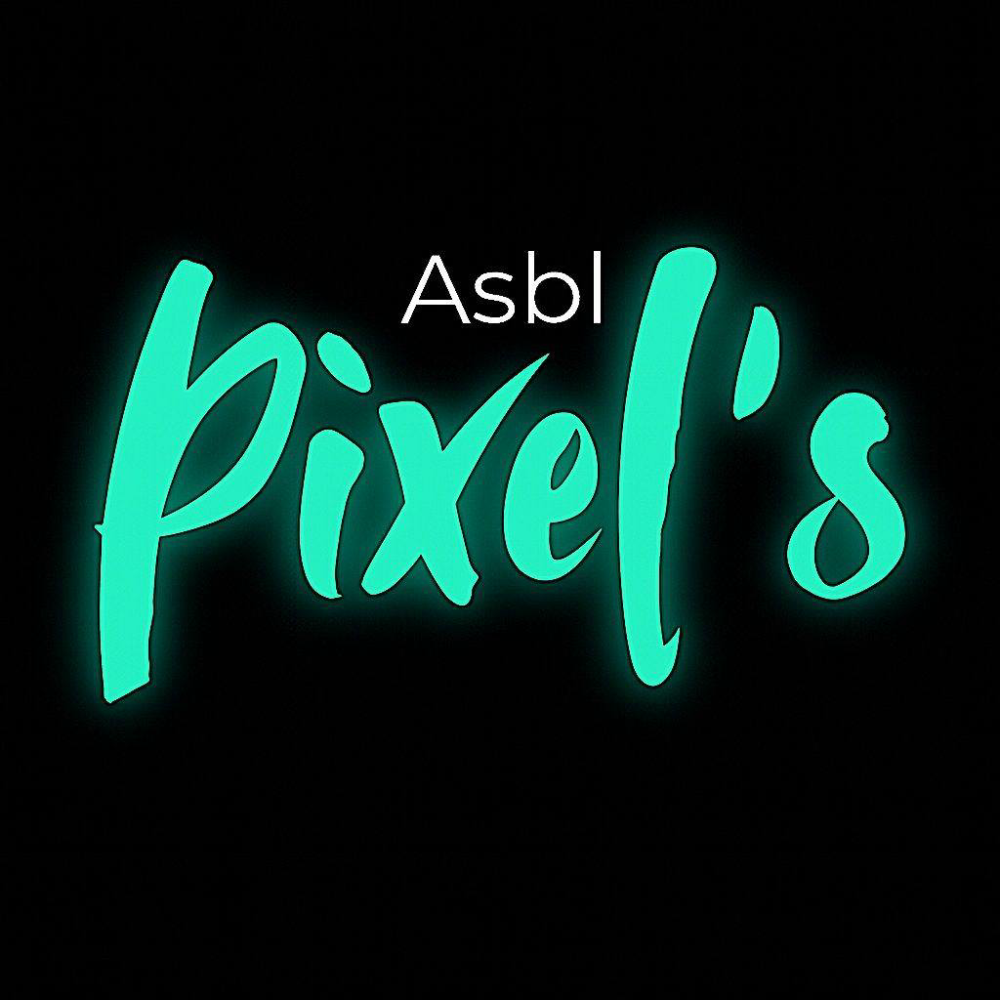

<div align="center">



# 🎬 RipDvD

### С диска в цифру — без усилий.

**Минималистичный инструмент для оцифровки DVD с открытым исходным кодом для Linux (Fedora / GNOME)**

[](LICENSE)
[](https://github.com/asblPixels/ripdvd)
[](https://gnome.org/)
[](https://gnome.org/)
[](https://www.python.org/)
[](https://handbrake.fr/)
[](https://github.com/asblPixels/ripdvd/releases)

<br>

[🇬🇧 English](README.md) · [🇫🇷 Français](README.fr.md) · [🇪🇸 Español](README.es.md) · [🇷🇺 Русский](README.ru.md) · [🇨🇳 中文](README.zh.md) · [🇯🇵 日本語](README.ja.md)

</div>

---

## 📖 О проекте

**RipDvD** — бесплатное приложение с открытым исходным кодом для оцифровки DVD под Linux и Windows.
Оно предоставляет нативный графический интерфейс (GTK4 / libadwaita под Linux, tkinter под Windows) поверх
[HandBrakeCLI](https://handbrake.fr/), превращая вашу коллекцию DVD в качественные
файлы MKV, готовые для домашнего медиасервера (Jellyfin, Kodi, Plex).

> **Происхождение**: Этот проект создан и поддерживается **[asblPixels](https://github.com/asblPixels)**
> в рамках инициативы по разработке программного обеспечения с открытым исходным кодом.
> Распространяется по лицензии MIT и свободен для использования, изменения и распространения.

### ✨ Почему RipDvD?

Большинство инструментов для оцифровки DVD — это либо только командная строка, либо слишком сложные,
либо привязанные к одной платформе, либо только для Windows. RipDvD стремится быть **максимально простым
инструментом**, работающим везде: вставьте диск, нажмите одну кнопку, получите идеальный MKV. Без настройки,
но с полным контролем при необходимости.
Работает на **Fedora, Arch, Ubuntu, Debian** (Linux) и **Windows 10/11**.

## 🎯 Возможности

- 🖱️ **Оцифровка в один клик** — вставьте DVD, нажмите *Rip DVD*, получите MKV, готовый к стримингу.
- 🔍 **Автоматическое определение основного фильма** — выбирает самый длинный заголовок (основной фильм).
- 🌍 **Многоязычное аудио** — обнаруживает все аудиодорожки; по умолчанию французский, затем английский.
- 💬 **Субтитры** — опциональный passthrough любой дорожки субтитров (VobSub) или без них.
- 📑 **Маркеры глав** — сохраняются в MKV для удобной навигации в Jellyfin/Kodi.
- 📺 **Окно вывода в реальном времени** — лог HandBrakeCLI в реальном времени с автопрокруткой.
- 📊 **Прогресс-бар** — процент обновляется в реальном времени во время кодирования.
- ⏸️ **Кнопка Стоп** — отмена кодирования в любой момент.
- 🔄 **Кнопка Возобновить** — повтор последнего кодирования с теми же параметрами.
- 🚪 **Кнопка Выход** — корректное закрытие приложения (сначала останавливает кодирование).
- 🔄 **Кнопка Пересканировать** — повторный анализ диска без перезапуска приложения.
- 🧹 **Очистить лог** — очистка окна вывода в реальном времени.
- 🎨 **Нативный вид GNOME** — GTK4 + libadwaita, идеально вписывается в Fedora Workstation.
- 🧵 **Потокобезопасность** — все обновления интерфейса передаются в главный поток GTK.
- 🐛 **Отладочный лог** — полный вывод сохраняется в `~/.ripdvd-debug.log`.

## 📋 Профиль вывода по умолчанию

| Параметр | Значение |
|---|---|
| Контейнер | MKV (Matroska) |
| Видеокодек | H.264 (x264), RF 20, пресет `medium` |
| Разрешение | Нативное DVD (480p NTSC / 576p PAL) — без апскейлинга |
| Частота кадров | Исходная (25 / 29,97 fps) |
| Аудио | Passthrough (копирование) — сохраняет оригинальный 5.1 при наличии |
| Субтитры | Passthrough (опционально) |
| Главы | Сохраняются |
| Типичный размер | ~1,0 – 1,5 ГБ на 2-часовой фильм |

> 💡 DVD — это SD-источники. Сохранение нативного разрешения избегает искусственного
> апскейлинга и сохраняет файлы компактными, отлично выглядя на любом телевизоре.

## 🖥️ Поддерживаемые системы

| Компонент | Требование |
|---|---|
| **Операционная система** | Fedora 43+ (протестировано на Fedora 45). Любая современная дистрибуция на базе Fedora/RHEL должна работать. |
| **Рабочий стол** | GNOME (GTK4/libadwaita). Работает на X11 и Wayland. |
| **Архитектура** | x86_64 |
| **CPU** | Любой x86_64 (программное кодирование через x264). GPU не требуется. |
| **RAM** | 2 ГБ минимум, 4 ГБ рекомендуется |
| **Диск** | ~1,5 ГБ свободного места на фильм (вывод) + ~8 ГБ временно во время кодирования |
| **Оптический привод** | Внутренний или USB DVD-привод (появляется как `/dev/sr0`) |

### Поддерживаемые дистрибутивы

Этот репозиторий предоставляет ветки для каждого дистрибутива с адаптированными установщиками:

| Ветка | Дистрибутив | Скрипт установки |
|---|---|---|
| `main` / `fedora` | Fedora 43+ | `scripts/install.sh` |
| `arch` | Arch Linux | `scripts/install-arch.sh` |
| `ubuntu` | Ubuntu 22.04+ | `scripts/install-ubuntu.sh` |
| `debian` | Debian 12+ | `scripts/install-debian.sh` |
| `windows` | Windows 10/11 | `scripts/install-windows.ps1` |

Для использования конкретной ветки:

```bash
git clone -b <ветка> https://github.com/asblPixels/ripdvd.git
cd ripdvd
bash scripts/install-<distro>.sh   # или .ps1 на Windows
```

## 🚀 Установка

### ⚡ Установка одной строкой (рекомендуется)

**Скопируйте и вставьте эту единственную команду в терминал:**

```bash
curl -fsSL https://raw.githubusercontent.com/asblPixels/ripdvd/main/scripts/install-linux.sh | bash
```

Вот и всё! Установщик:
1. Автоматически определит ваш дистрибутив Linux.
2. Установит все необходимые зависимости.
3. Скачает и установит RipDvD.
4. Настроит пункт меню.

> **Технические знания не требуются.** Скопируйте, вставьте, нажмите Enter.

### Шаг 1 — Загрузка (вручную)

```bash
git clone https://github.com/asblPixels/ripdvd.git
cd ripdvd
```

> Нет `git`? Скачайте ZIP с
> https://github.com/asblPixels/ripdvd/archive/refs/heads/main.zip и распакуйте.

### Шаг 2 — Установка зависимостей

```bash
sudo dnf install -y python3 python3-gobject gtk4 libadwaita zenity HandBrake HandBrake-cli
```

Для зашифрованных коммерческих DVD также установите `libdvdcss`:

```bash
sudo dnf install -y rpmfusion-free-release-tainted
sudo dnf install -y libdvdcss
```

### Шаг 3 — Запуск установщика

```bash
bash scripts/install.sh
```

Установщик:
1. Проверит зависимости Python/GTK.
2. Установит HandBrake (нативный, с запасным Flatpak, если нативный недоступен).
3. Скопирует приложение в `~/.local/bin/ripdvd-gui.py`.
4. Зарегистрирует пункт меню GNOME (`ripdvd`).

### Шаг 4 — Запуск

```bash
python3 ~/.local/bin/ripdvd-gui.py
```

Или найдите **RipDvD** в меню приложений GNOME.

### Проверка работоспособности

```bash
python3 -c "import gi; gi.require_version('Gtk','4.0'); gi.require_version('Adw','1'); print('GTK4/Adw OK')"
command -v HandBrakeCLI && echo "HandBrakeCLI OK"
```

Обе команды должны вывести `OK`.

## 🎬 Использование

1. Вставьте DVD в привод.
2. Запустите **RipDvD** из меню GNOME (или `python3 ~/.local/bin/ripdvd-gui.py`).
3. Приложение автоматически просканирует диск и определит основной фильм (самый длинный заголовок).
4. Выберите **язык аудио** и опциональные **субтитры** из выпадающих списков.
5. Нажмите **Rip DVD**.
6. Наблюдайте за прогрессом в реальном времени в окне лога.
7. Готовый MKV появится в `~/Vidéos/Rips/` (или `~/Videos/Rips/`).

### Кнопки

| Кнопка | Действие |
|---|---|
| **Rip DVD** | Начать кодирование выбранного заголовка. |
| **Arrêter** | Отменить текущее кодирование. |
| **Reprendre** | Повторить последнее кодирование с теми же параметрами. |
| **Quitter** | Закрыть приложение (сначала останавливает кодирование). |
| **Rescanner** | Повторно проанализировать диск (полезно после смены DVD). |
| **Effacer log** | Очистить окно вывода в реальном времени. |

### CLI-версия

Также предоставлен headless bash-скрипт для автоматизации:

```bash
bash src/ripdvd-cli.sh
```

Он автоматически определяет самый длинный заголовок и оцифровывает его с теми же параметрами по умолчанию, показывая прогресс через `zenity`.

## 🗂️ Структура проекта

```
ripdvd/
├── src/
│   ├── ripdvd.py          # GUI-приложение GTK4/libadwaita
│   └── ripdvd-cli.sh      # Headless CLI-риппер
├── scripts/
│   └── install.sh         # Установщик для Fedora
├── data/
│   └── ripdvd.desktop     # Пункт меню GNOME
├── docs/
│   └── screenshot-main.png
├── .github/
│   ├── workflows/         # CI (проверки синтаксиса)
│   └── ISSUE_TEMPLATE/
├── README.md
├── LICENSE
├── CONTRIBUTING.md
└── .gitignore
```


### Windows

Для Windows 10/11 скачайте ZIP с https://github.com/asblPixels/ripdvd/archive/refs/heads/windows.zip, распакуйте и дважды щёлкните `install-windows.bat`. Технические знания не требуются.

## 🐛 Устранение неполадок

### Приложение не запускается — `ModuleNotFoundError: No module named 'gi'`
Установите PyGObject: `sudo dnf install python3-gobject gtk4 libadwaita`

### Segfault / сбой при запуске
Убедитесь, что у вас последняя версия (потокобезопасные обновления интерфейса). Перезапустите `bash scripts/install.sh`.

### DVD не обнаружен (`/dev/sr0` не найден)
- Проверьте подключение привода: `lsblk | grep sr`
- Некоторым USB-приводам нужно время после вставки; нажмите **Rescanner**.

### Чёрный экран / "cannot read disc" на зашифрованных DVD
Установите `libdvdcss`:
```bash
sudo dnf install rpmfusion-free-release-tainted
sudo dnf install libdvdcss
```

### Пустой выходной файл
Откройте отладочный лог (`~/.ripdvd-debug.log`) или нажмите **Voir le log de debug**. Последние строки покажут ошибку HandBrake. Частые причины:
- Отсутствует `libdvdcss` для зашифрованных дисков.
- HandBrake Flatpak без `--device=all` (исправлено в текущей версии).
- Недостаточно места на диске в `~/Vidéos/Rips/`.

### Медленное кодирование на старых CPU
Это нормально — программное кодирование x264 на i3 Sandy Bridge занимает ~10-15 мин на фильм. Приложение использует пресет `medium` для хорошего баланса качества/скорости. Для более быстрой оцифровки измените `--encoder-preset` на `fast` или `veryfast` в `src/ripdvd.py`.

## 🙏 Благодарности

Этот проект не существовал бы без невероятной работы:

- **[HandBrake](https://handbrake.fr/)** и его команды — движок кодирования, который делает всё возможным.
- **[libdvdcss](https://www.videolan.org/developers/libdvdcss.html)** (VideoLAN) — расшифровка DVD.
- **[GNOME / GTK4 / libadwaita](https://gnome.org/)** — набор инструментов интерфейса.
- **[RPM Fusion](https://rpmfusion.org/)** — пакетирование для Fedora.
- **[Проект Fedora](https://fedoraproject.org/)** — операционная система.
- Всех контрибьюторов с открытым исходным кодом и сообщество.

## 📚 Источники и ссылки

- Документация CLI HandBrake: https://handbrake.fr/docs/en/latest/cli/
- Документация libdvdcss: https://www.videolan.org/developers/libdvdcss.html
- Документация GTK4 / libadwaita: https://docs.gtk.org/gtk4/ и https://gnome.pages.gitlab.gnome.org/libadwaita/
- Документация PyGObject: https://pygobject.readthedocs.io/
- Конфигурация RPM Fusion: https://rpmfusion.org/Configuration
- Руководство по мультимедиа Fedora: https://docs.fedoraproject.org/en-US/quick-docs/assembly_installing-plugins-for-playing-movies-and-music/

## 👨‍💻 Создатели

**RipDvD** создан и поддерживается **[asblPixels](https://github.com/asblPixels)**
в рамках инициативы по разработке программного обеспечения с открытым исходным кодом.

Вклад, отчёты об ошибках и запросы функций приветствуются!

## 📜 Лицензия

Этот проект распространяется под лицензией **MIT** — см. [LICENSE](LICENSE) для подробностей.

## ⚠️ Правовая оговорка

Этот инструмент предназначен для резервного копирования DVD, которыми вы владеете, для личного использования.
Расшифровка защищённых от копирования дисков может быть ограничена в вашей стране. Проверьте местное законодательство.

---

<div align="center">

Сделано с ❤️ by [asblPixels](https://github.com/asblPixels) · Открытый исходный код · Лицензия MIT

</div>
